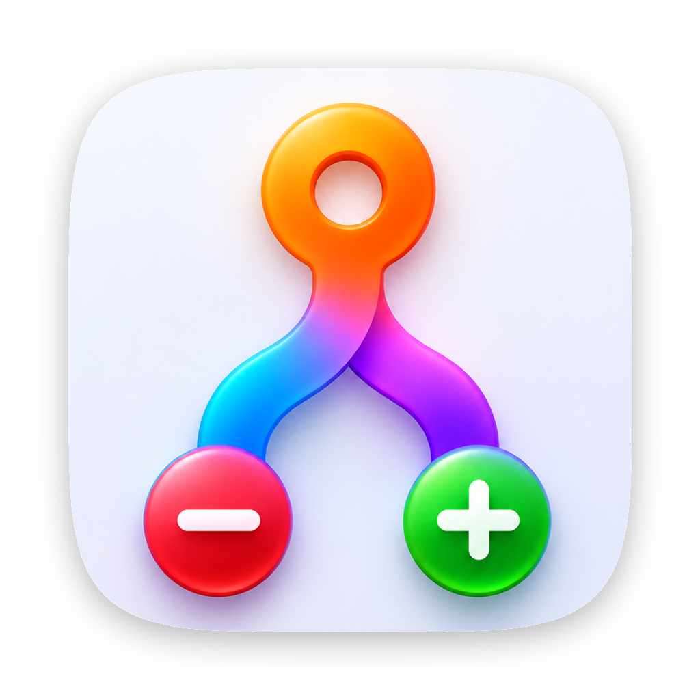
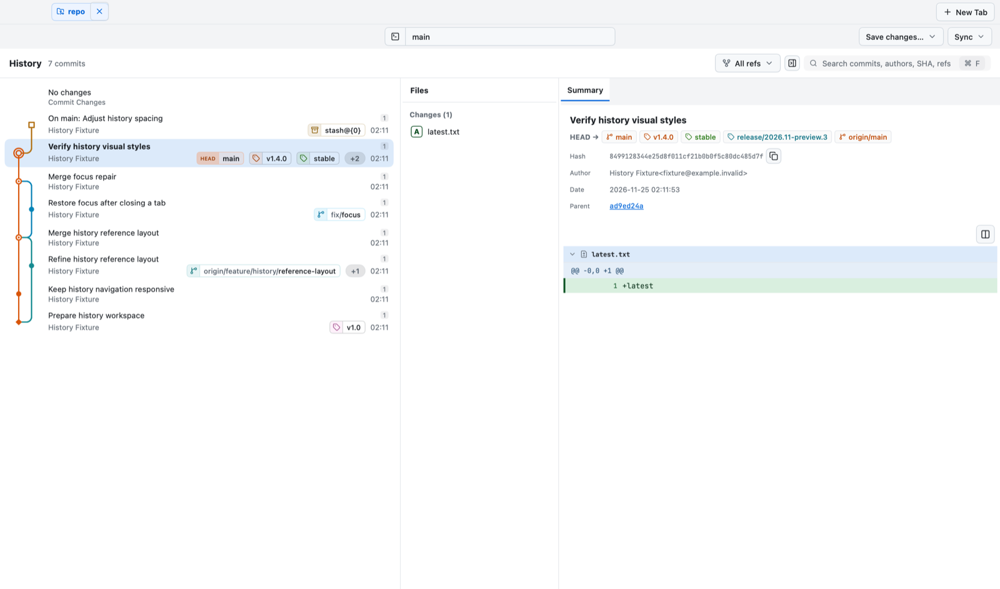
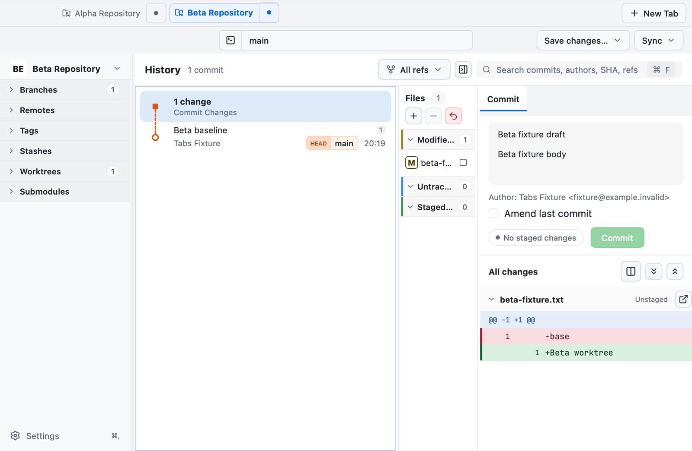
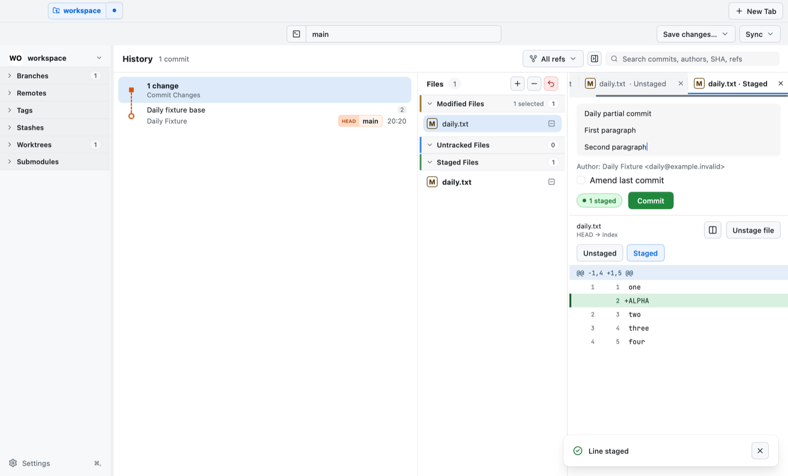
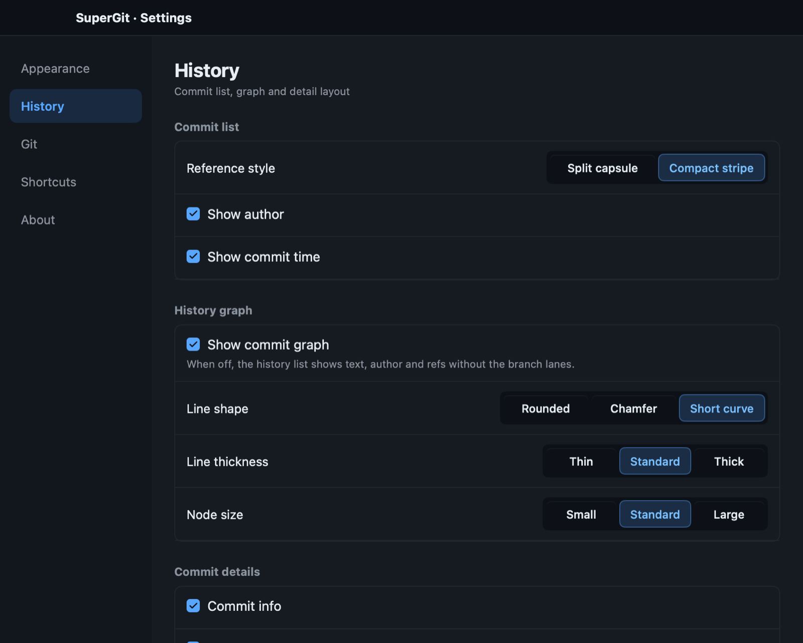

<p align="center">
  
</p>

<h1 align="center">SuperGit</h1>

<p align="center">A native Git workbench for exploring history, reviewing changes, and working across repositories.</p>

<p align="center">
  English · <a href="README.zh-CN.md">简体中文</a><br>
  <a href="https://github.com/lane128/SuperGit/releases/latest">Download</a> ·
  <a href="#features">Features</a> ·
  <a href="#build-from-source">Build from source</a> ·
  <a href="docs/shortcuts.md">Shortcuts</a>
</p>

SuperGit brings commit history, working changes, staging, and repository navigation into one desktop window. Built with Go, [MyGo](https://github.com/egoist/mygo), and [Lobe MyGo](https://mygo.lobehub.com), it renders a GPU-accelerated native interface without a WebView and runs Git operations through your system Git.

**Available for macOS on Apple Silicon.** English and Simplified Chinese interfaces, light and dark themes. Licensed under GPL-3.0.



*Follow branches and merges on the left; inspect the selected commit and changed files on the right. Screenshots use isolated demo repositories, not personal project data.*

## Download and install

1. Open the [latest GitHub Release](https://github.com/lane128/SuperGit/releases/latest).
2. Download the `SuperGit-<version>-darwin-arm64.zip` asset and extract it.
3. Move `SuperGit.app` to **Applications**, then launch it and open a local Git repository.

The download includes the application; **Go is only needed to build from source**. System Git must be available. The current release provides an Apple Silicon binary; Intel macOS, Windows, and Linux binaries are not provided.

> **macOS signing:** the app is ad-hoc signed and is not Apple Developer ID signed or notarized. Gatekeeper may block a downloaded copy. Releases include `SHA256SUMS.txt` for checking the download and `update.json` for in-app updates. Update archives are verified with Ed25519; this does not replace Apple notarization. See [Packaging & Release Signing](docs/packaging.md).

## Features

### Keep repositories together

Open repositories in tabs, reorder them, and return to a closed tab with `⌘⇧T`. Dirty indicators show which repositories have uncommitted work, and session restore brings your tabs back after a restart. Local file watching and incremental refresh keep the workbench up to date as you edit in another application.

The sidebar groups **branches, remotes, tags, stashes, worktrees, and submodules**, while each repository keeps its own working context.



*Switch projects without opening a separate application window for each repository.*

### Read history and follow branches

- Browse a commit graph built from actual parent relationships, including branches and merges.
- Search commits by message, author, SHA, or reference and filter the history by refs.
- Inspect changed files, commit metadata, tags, and branch labels alongside the graph.
- Explore file history and blame when you need to trace a change.
- Choose **Rounded**, **Chamfer**, or **Short curve** connections, independently of the **Split capsule** or **Compact stripe** label style.

### Build commits from the changes you choose

Review unified or side-by-side diffs, then stage whole files, individual hunks, or selected lines. Modified, untracked, and staged files are grouped separately. The staged and unstaged versions of the same file can stay open in separate detail tabs, so you can see exactly what the next commit will contain.

Write a commit message, create a commit, or amend the previous one. Image changes also have a preview.



*Only the selected addition is staged here; other edits remain in the working tree.*

### Handle everyday Git workflows

| Area | What you can do |
| --- | --- |
| Branches & tags | Create and switch branches, manage local tags, and work with remote-tracking branches. |
| Sync | Fetch, pull with fast-forward semantics, push, and use force-with-lease when explicitly needed; inspect ahead/behind counts and transfer progress. |
| History operations | Merge, rebase, cherry-pick, revert, and reset through the application. |
| Conflicts | Compare Base / Ours / Theirs and edit the result in the built-in three-way text editor. Residual conflict markers are checked before marking a file resolved. |
| Stashes | Save unfinished work, preview a stash, apply or pop it, and remove entries. |
| Worktrees & submodules | Work with additional checkouts and inspect, open, or update submodules. |

Remote authentication uses your system Git credential helper and SSH agent. SuperGit does not store remote access tokens.

### Adjust the workspace to your habits

Use the command palette (`⌘P`) to find actions, quick checkout (`⌘B`) to switch branches, and the repository switcher (`⌘⇧O`) to move between projects. Settings include interface language, light/dark themes, separate UI and code font options, diff palettes, and history layout controls.



*Three graph shapes × two label styles give six combinations. Changes apply immediately and persist across restarts.*

## Your first workflow

1. **Open a repository** with `⌘O`, or use the welcome screen to clone or create one.
2. **Review working changes** in History's working-tree row; select a file to inspect its diff.
3. **Stage what belongs together**—a file, a hunk, or selected lines—and check the staged diff.
4. **Commit** with a message describing the change, then use **Sync** to fetch, pull, or push.

For unfinished work, use Stash; for parallel work on another branch, use a worktree.

## Common shortcuts

| Shortcut | Action |
| --- | --- |
| `⌘P` / `⌘⇧P` | Open the command palette |
| `⌘B` | Quick checkout |
| `⌘O` | Open a repository |
| `⌘⇧O` | Switch repositories |
| `⌘⇧T` | Reopen a closed repository tab |
| `⌘0` | Jump to HEAD |
| `⌘9` | Open working changes and focus the commit title |
| `⌘R` | Refresh the repository |
| `⌘↵` | Commit staged changes when the commit view is active and ready |
| `⌘,` | Open settings |

See the [full shortcut reference](docs/shortcuts.md) for context-specific keys and behavior.

## Build from source

Requirements: **macOS on Apple Silicon**, **Go 1.27.3 or later**, **Xcode Command Line Tools** (CGO and the macOS SDK), and **Git**. The pinned MyGo source is included under `third_party/mygo`.

```sh
git clone https://github.com/lane128/SuperGit.git
cd SuperGit

# Build and launch the native macOS bundle.
make app
open build/SuperGit.app

# Or launch the built executable with a repository path.
./build/supergit /path/to/repository
```

Development commands:

```sh
make demo          # Launch with a temporary demo repository.
make test          # Run Go tests.
make check         # Run tests, race checks, SDK checks, and go vet.
make native-check  # Exercise the standard app using isolated native fixtures.
```

Run repository-wide Go checks from a clean checkout if previous native runs left fixture repositories under `build/`; those fixture sources can be picked up by `go test ./...`.

## Documentation and feedback

- [Keyboard shortcuts](docs/shortcuts.md)
- [Packaging, signing, and updates](docs/packaging.md)
- [Native automation](docs/e2e-automation.md)
- [History graph and reference styles](docs/graph-colors.md)
- [1.0.0 release verification](docs/acceptance/2026-11-25/release-1.0.0.md)
- [Report a bug or request a feature](https://github.com/lane128/SuperGit/issues)

When reporting a bug, include the app version, macOS version, reproduction steps, and expected versus actual behavior. Remove credentials, private repository URLs, and personal data from logs or screenshots.

## License and credits

SuperGit is licensed under [GNU General Public License v3.0](LICENSE).

Built with [Go](https://go.dev/), [MyGo](https://github.com/egoist/mygo), and [Lobe MyGo](https://mygo.lobehub.com). Bundled fonts use the SIL Open Font License 1.1; see [font licenses](internal/lobedesk/fonts/LICENSES.txt). Screenshot sources are documented in [docs/images/README.md](docs/images/README.md).
