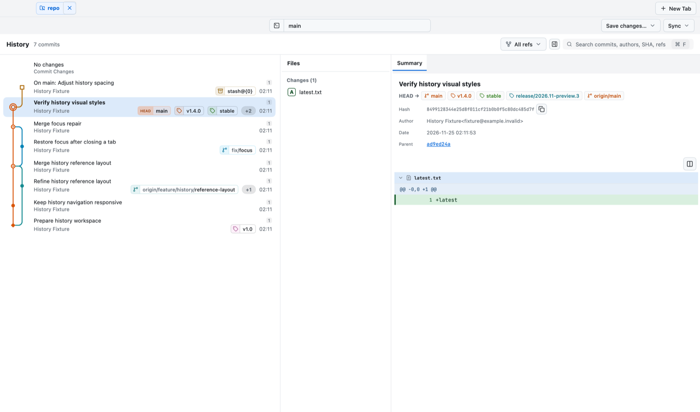
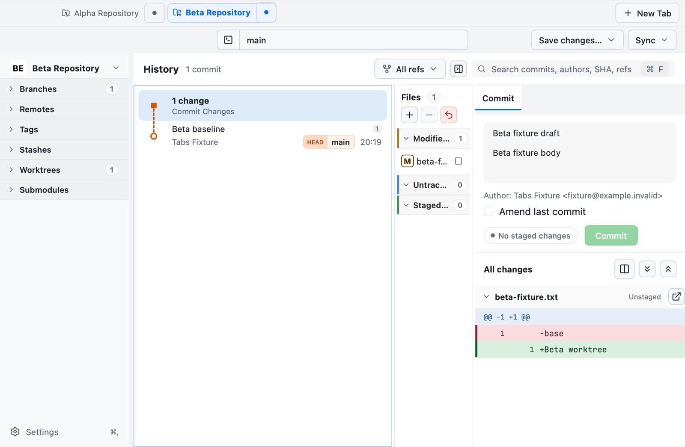
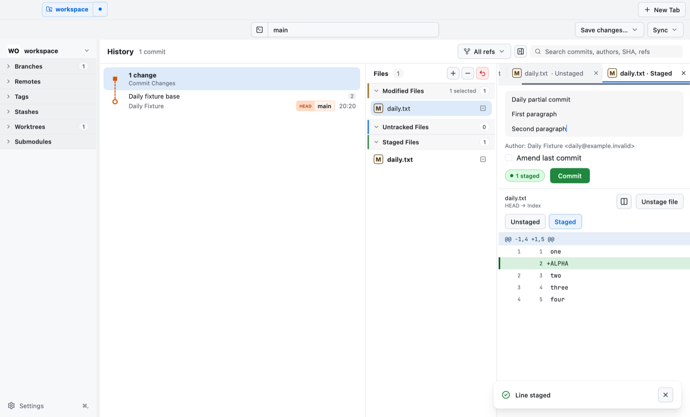
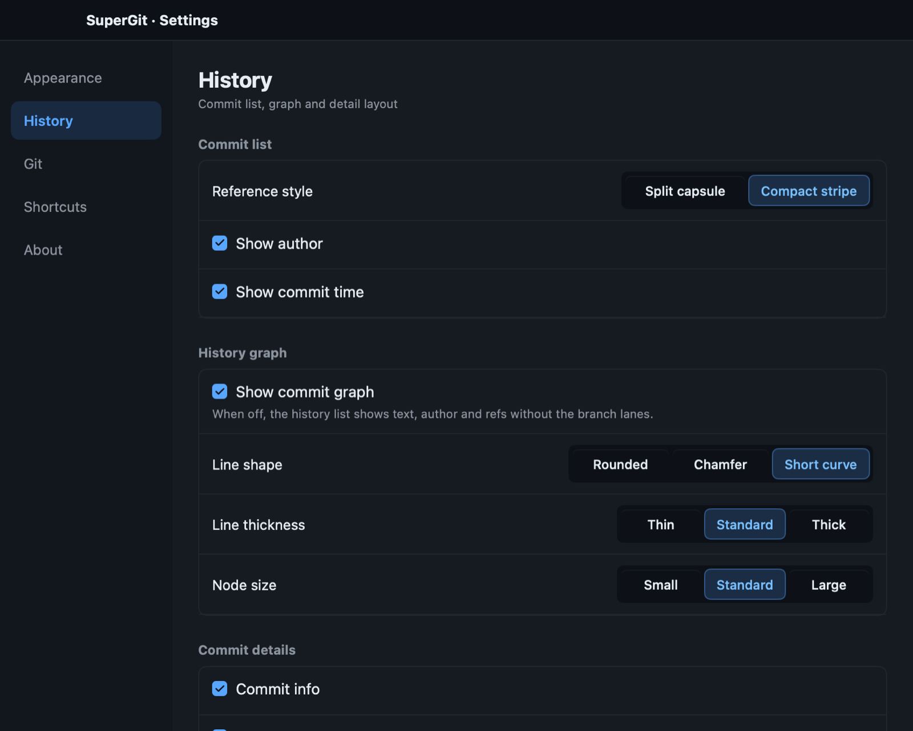

<p align="center">
  
</p>

<h1 align="center">SuperGit</h1>

<p align="center">在一个原生 Git 工作台里，读懂提交历史、审查代码改动、管理多个仓库。</p>

<p align="center">
  <a href="README.md">English</a> · 简体中文<br>
  <a href="https://github.com/lane128/SuperGit/releases/latest">下载应用</a> ·
  <a href="#核心功能">核心功能</a> ·
  <a href="#从源码构建">从源码构建</a> ·
  <a href="docs/shortcuts.md">快捷键</a>
</p>

SuperGit 把提交历史、工作区改动、暂存与仓库导航放在同一个桌面窗口中。使用 Go、[MyGo](https://github.com/egoist/mygo) 和 [Lobe MyGo](https://mygo.lobehub.com) 构建，以 GPU 加速的原生界面呈现，不使用 WebView，Git 操作直接调用系统 Git。

**目前提供 macOS Apple Silicon 版本。** 支持简体中文与英文、浅色与深色主题，采用 GPL-3.0 开源协议。



*左侧沿分支与合并关系浏览历史，右侧查看选中提交和文件改动。本文截图来自隔离的演示仓库，不包含个人项目数据。*

## 下载安装

1. 打开 [GitHub 最新发布页](https://github.com/lane128/SuperGit/releases/latest)。
2. 下载 `SuperGit-<版本号>-darwin-arm64.zip` 并解压。
3. 将 `SuperGit.app` 拖入「应用程序」，启动后打开本地 Git 仓库。

下载包已包含应用，**仅从源码构建时才需要 Go**。运行时需要系统 Git。目前提供 Apple Silicon 安装包，未提供 Intel macOS、Windows 或 Linux 安装包。

> **macOS 签名说明：** 应用目前采用 ad-hoc 签名，没有 Apple Developer ID 签名与公证，下载后可能被 Gatekeeper 拦截。发布页提供 `SHA256SUMS.txt` 用于校验下载文件，`update.json` 用于应用内更新；更新包使用 Ed25519 验签，该机制不等同于 Apple 公证。详见[打包与发布签名](docs/packaging.md)。

## 核心功能

### 在一个窗口管理多个仓库

以标签页打开仓库，拖拽调整顺序，用 `⌘⇧T` 重开关闭的标签。未提交改动标记帮助你识别哪些仓库还有工作，重启后可恢复会话。通过本地文件监听和增量刷新，在编辑器中修改文件后，工作台会同步更新。

侧栏集中展示**分支、远端、标签、Stash、Worktree 和子模块**，各仓库保留各自的工作上下文。



*切换项目，无需为每个仓库单独打开一个应用窗口。*

### 沿着分支读懂提交历史

- 根据提交的真实父子关系绘制历史图，展示分支与合并路径。
- 按提交信息、作者、SHA 或引用搜索，并通过引用筛选历史范围。
- 在历史图旁查看提交信息、改动文件、分支名与标签。
- 通过文件历史和 Blame 追溯改动来源。
- 连线提供 **Rounded（圆角）／Chamfer（斜角）／Short curve（短曲线）**，引用标签提供 **Split capsule（分段胶囊）／Compact stripe（紧凑条纹）**，两组设置互相独立。

### 只把需要的改动放进下一次提交

使用统一或左右分栏 Diff 审查改动，按整个文件、片段（Hunk）或选中行暂存。已修改、未跟踪与已暂存文件分别分组；同一文件的已暂存和未暂存版本可以同时打开在不同详情标签中，便于核对下一次提交究竟包含什么。

填写提交信息后创建 Commit，也可以 Amend 上一次提交；图片改动同样支持预览。



*图中只暂存了选中的新增行，其余编辑仍留在工作区。*

### 完成日常 Git 操作

| 场景 | 支持的操作 |
| --- | --- |
| 分支与标签 | 创建、切换分支，管理本地标签，使用远端跟踪分支。 |
| 远端同步 | Fetch、仅快进 Pull、Push、显式执行 Force-with-lease；查看领先／落后提交数和传输进度。 |
| 历史操作 | 在应用中执行 Merge、Rebase、Cherry-pick、Revert 和 Reset。 |
| 冲突处理 | 使用内置三方文本编辑器对比 Base／Ours／Theirs 并编辑结果；标记解决前检查残留冲突标记。 |
| 暂存工作 | 保存、预览、应用、弹出和删除 Stash。 |
| 多检出与子模块 | 管理额外的 Worktree，查看、打开或更新子模块。 |

远端认证沿用系统 Git 凭据助手与 SSH Agent，SuperGit 不保存远端访问令牌。

### 调整为自己的使用习惯

用命令面板（`⌘P`）查找操作，用快速检出（`⌘B`）切换分支，用仓库切换器（`⌘⇧O`）跳转项目。设置中可以调整界面语言、浅色／深色主题、独立的界面与代码字体、Diff 配色，以及历史布局。



*三种连线 × 两种标签，共六种组合；修改即时生效，重启后保留。*

## 第一次使用

1. **打开仓库**：按 `⌘O` 选择本地目录，或在欢迎页克隆／新建仓库。
2. **检查改动**：在历史页选中工作区行，再选择文件查看 Diff。
3. **整理暂存内容**：按文件、片段或选中行暂存，核对已暂存版本。
4. **提交与同步**：填写提交信息并提交，再通过 **Sync** 获取、拉取或推送远端改动。

未完成的工作可以先存入 Stash；需要同时处理另一个分支时，可以使用 Worktree。

## 常用快捷键

| 快捷键 | 操作 |
| --- | --- |
| `⌘P` / `⌘⇧P` | 打开命令面板 |
| `⌘B` | 快速检出分支 |
| `⌘O` | 打开仓库 |
| `⌘⇧O` | 切换仓库 |
| `⌘⇧T` | 重开关闭的仓库标签 |
| `⌘0` | 跳到 HEAD |
| `⌘9` | 打开工作区改动并聚焦提交标题 |
| `⌘R` | 刷新仓库 |
| `⌘↵` | 在提交视图已激活且就绪时提交暂存内容 |
| `⌘,` | 打开设置 |

不同焦点位置下的键位与详细行为见[完整快捷键说明](docs/shortcuts.md)。

## 从源码构建

需要 **macOS Apple Silicon**、**Go 1.27.3 或更高版本**、**Xcode Command Line Tools**（CGO 与 macOS SDK）和 **Git**。仓库已在 `third_party/mygo` 中包含固定版本的 MyGo 源码。

```sh
git clone https://github.com/lane128/SuperGit.git
cd SuperGit

# 构建并打开原生 macOS 应用包。
make app
open build/SuperGit.app

# 或使用构建后的可执行文件打开指定仓库。
./build/supergit /path/to/repository
```

开发与验证命令：

```sh
make demo          # 使用临时演示仓库启动。
make test          # 运行 Go 测试。
make check         # 运行测试、竞态检测、SDK 检查和 go vet。
make native-check  # 用隔离 fixture 验证标准应用的原生操作。
```

如果此前的原生测试在 `build/` 下留下了 fixture 仓库，请在干净检出中执行全仓库 Go 检查；`go test ./...` 可能将这些 fixture 源码也纳入扫描。

## 文档与反馈

- [快捷键说明](docs/shortcuts.md)
- [打包、签名与自动更新](docs/packaging.md)
- [原生自动化](docs/e2e-automation.md)
- [历史图与引用标签规则](docs/graph-colors.md)
- [1.0.0 发布验证记录](docs/acceptance/2026-11-25/release-1.0.0.md)
- [反馈问题或提出功能建议](https://github.com/lane128/SuperGit/issues)

反馈问题时，请提供应用版本、macOS 版本、复现步骤，以及预期与实际行为。分享日志或截图前，请去除凭据、私有仓库地址和个人信息。

## 许可证与致谢

SuperGit 采用 [GNU General Public License v3.0](LICENSE) 开源协议。

基于 [Go](https://go.dev/)、[MyGo](https://github.com/egoist/mygo) 和 [Lobe MyGo](https://mygo.lobehub.com) 构建。内置字体遵循 SIL Open Font License 1.1，详见[字体许可证](internal/lobedesk/fonts/LICENSES.txt)。截图来源见 [docs/images/README.md](docs/images/README.md)。
